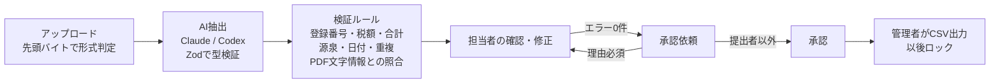

# 請求書AIワークフロー

**請求書のPDF・画像をAIが読み取り、インボイス制度の要件と計算を自動で検証し、担当者の確認 → 承認者の承認 → 仕訳CSV出力までを、権限と監査ログつきで処理する業務システム。**

[](https://github.com/Ryou-Koshimizu/japanese-invoice-workflow/actions/workflows/ci.yml)
[](LICENSE)
[](https://vercel.com/new/clone?repository-url=https%3A%2F%2Fgithub.com%2FRyou-Koshimizu%2Fjapanese-invoice-workflow)


上は公開デモの実画面です（AIは呼ばず、同梱のサンプルは事前に用意した読み取り結果を使用）。税額の誤りをルールが検出し、修正すると再検証で解消され、承認・出力・監査ログまで流れます。

## 何ができるか

- **AIは読むだけ、判定はルール**：取引先・登録番号・税率ごとの金額と税額・源泉徴収・明細を構造化して抽出。正しさは決定的な検証ルールが判定し、PDFの文字情報と照合してAIの捏造も疑う
- **インボイス制度の実務**：登録番号の形式と法人番号の検査数字、適格請求書の記載事項、税率ごとの端数処理、源泉徴収（10.21% / 20.42%）、二重計上
- **人が見るのは問題の箇所だけ**：エラー・警告・AIが自信のない項目だけを強調。原本と並べて修正し、AIの値からの変更を表示
- **承認フローと権限**：担当者・承認者・管理者。自己承認の禁止、差し戻し理由の必須、出力済みのロックを**データベースで**強制
- **業務SaaSとしての土台**：組織ごとのデータ分離（RLS）、改ざんできない監査ログ、プラン上限とStripe課金

## 実測

| 指標                                         | 結果                                                                                                                                        |
| -------------------------------------------- | ------------------------------------------------------------------------------------------------------------------------------------------- |
| 権限・分離のテスト                           | PGliteと実PostgreSQL 16の両方で、他組織の参照・自己承認・出力済みの編集・監査ログの改変・パスワードハッシュの参照がDBで拒否されることを確認 |
| 単体・DB・E2Eテスト                          | 50件 + 実PostgreSQL 3件 + ブラウザ4件、すべて成功（GitHub ActionsのCIで毎回実行）。axeのWCAG A/AA違反0件                                    |
| 誤りを含む請求書の検出（正解データ、AIなし） | 6/6                                                                                                                                         |
| **実AIの抽出精度・時間・費用**               | **未測定**。`npm run eval` で40枚を測定する（下記）                                                                                         |

詳しくは [検証記録](docs/verification.md)。提出・レビュー向けの説明は [業務シナリオと導入条件](docs/freelance-submission.md)。

## 試す

### 公開デモ（APIキー・DB不要）

```sh
npm ci
cp .env.example .env.local
npm run dev
```

<http://127.0.0.1:3000> で役割を選んでログインします。プロセス内のPostgreSQL（PGlite）に、架空の会社と7枚の請求書が本番と同じ処理で入っています。

1. **担当者**で「株式会社アオバ通信」を開く → 税額のエラーを修正して承認依頼
2. **承認者**で承認（自分の依頼は承認できないことも確認できます）
3. **管理者**で仕訳CSVを出力 → 監査ログを確認

### 自分の請求書で（実運用モード）

PostgreSQLと、Claude APIキーまたはChatGPTのログイン（Codex CLI）を使います。手順は [ローカル実行と実運用モード](docs/local-setup.md)。

## 設計



| 層               | 実装                                                                                                                |
| ---------------- | ------------------------------------------------------------------------------------------------------------------- |
| 権限と業務ルール | [db/schema.sql](db/schema.sql)：RLS、遷移を検査するトリガー、監査ログのトリガー、プラン上限                         |
| 検証ルール       | [src/core/rules.ts](src/core/rules.ts)、[src/core/crosscheck.ts](src/core/crosscheck.ts)：AIを使わない純粋関数      |
| AI抽出           | [src/adapters](src/adapters)：Claude（PDF・画像）、Codex（画像）、デモ用データ。差し替え境界は `ExtractionProvider` |
| 業務処理         | [src/server/service.ts](src/server/service.ts)：すべて `asUser()` で制限ロールとして実行                            |
| 課金             | [src/server/billing.ts](src/server/billing.ts)：署名検証、イベントIDで一度だけ反映                                  |
| 仕訳CSV          | [src/core/csv.ts](src/core/csv.ts)：税率ごとの借方、源泉徴収の預り金、数式の無効化、BOM付き                         |

判断の記録：[DBで業務ルールを強制](docs/adr/001-database-enforced-workflow.md) / [外部サービスに依存しない認証と保存](docs/adr/002-self-contained-auth-and-storage.md) / [AIを呼ばない公開デモ](docs/adr/003-demo-without-ai.md) / [検証ルールをAIから独立](docs/adr/004-validation-independent-of-ai.md) / [脅威と対策](docs/security.md)

## 評価

架空の請求書40枚（標準12、軽減税率の混在10、源泉徴収6、読み取りにくい画像6、誤りを含む6）を [生成スクリプト](scripts/generate-invoices.ts) で作り、正解データとともに同梱しています。会社名・登録番号はすべて架空です。

```sh
npm run eval   # EXTRACTION_PROVIDER=claude または codex
```

金額は1円単位、日付・登録番号は完全一致、名称は空白と記号の違いを許容して項目ごとに採点し、必須項目がすべて正しかった割合と、誤りを含む請求書をAI経由でも検出できたかを出します。結果はモデル名・コミット・データとプロンプトのハッシュとともに `reports/` に保存します。デモ用データやモックの結果は精度に数えません。

## セキュリティ

- 権限・組織の分離・承認フロー・監査ログはデータベースで強制し、アプリは制限ロールでのみ接続します（[脅威と対策](docs/security.md)）
- CSP・HSTS等のセキュリティヘッダー、Originの検査、アカウント単位のログイン試行制限、先頭バイトによるファイル判定
- GitHub ActionsはコミットSHAで固定し最小権限。CodeQL・Dependabot・依存関係の審査・Secret scanningを有効化
- 公開前に、全履歴の秘密情報・個人情報・画像とPDFのメタデータ・登録番号の実在を点検しました（[公開前のセキュリティ確認](docs/security-publication.md)）

脆弱性の報告は [SECURITY.md](SECURITY.md) の手順で非公開でお願いします。

## 開発

```sh
npm run typecheck && npm test && npm run build
npx playwright install chromium && npm run test:e2e
npm run db:up && RUN_POSTGRES_TESTS=1 npx vitest run tests/postgres.test.ts
```

対象外：会計ソフトへのAPI連携、支払い処理、電子帳簿保存法の要件を満たす保存、SSO。[要件定義](docs/requirements.md) に状態を記載しています。

## License

MIT。請求書・会社・人物はすべて架空です。登録番号は乱数で作った架空の番号で、国税庁の公表サイトで登録がないことを確認済みです（検査数字の計算確認にだけ、国税庁自身の公表された法人番号を使っています）。
