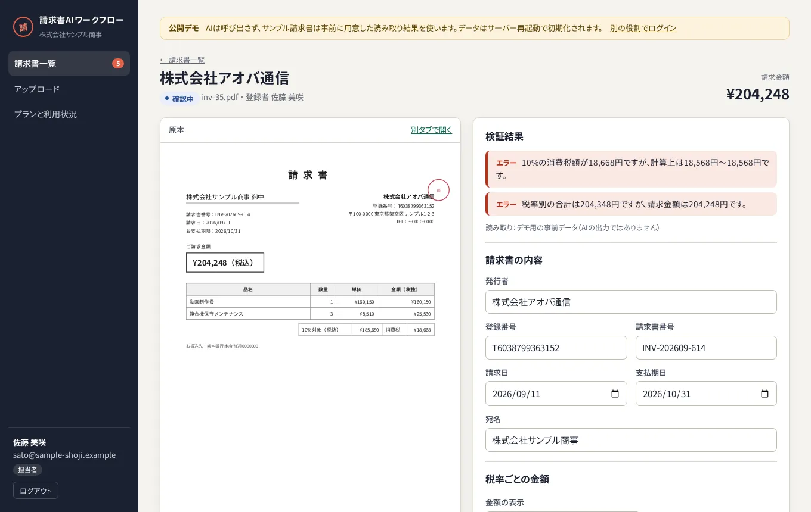
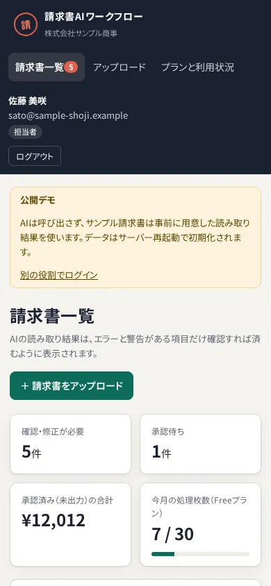
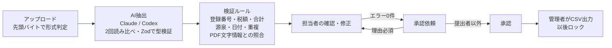

# 請求書AIワークフロー

**請求書のPDF・画像をAIが読み取り、インボイス制度の要件と計算を自動で検証し、担当者の確認 → 承認者の承認 → 仕訳CSV出力までを、権限と監査ログつきで処理する業務システム。**

[](https://github.com/Ryou-Koshimizu/japanese-invoice-workflow/actions/workflows/ci.yml)
[](LICENSE)
[](https://japanese-invoice-workflow.vercel.app)


上は公開デモの実画面です（AIは呼ばず、同梱のサンプルは正解データから作った読み取り結果を使用）。税額の誤りをルールが検出し、修正すると再検証でチェックが付き直し、承認のスタンプ・仕訳CSVの出力・監査ログまで流れます。

<p>
  
  
</p>

## 何ができるか

- **AIは読むだけ、判定はルール**：取引先・登録番号・税率ごとの金額と税額・源泉徴収・明細を構造化して抽出。正しさは決定的な検証ルールが判定し、PDFの文字情報と照合してAIの捏造も疑う
- **2回読み比べる**：同じ請求書をAIに2回独立に読ませ、食い違った項目は3回目の多数決で決める。それでも決まらない項目は人の確認に回す（[ADR 005](docs/adr/005-consensus-reading.md)）
- **インボイス制度の実務**：登録番号の形式と法人番号の検査数字、適格請求書の記載事項、税率ごとの端数処理、源泉徴収（10.21% / 20.42%）、二重計上
- **人が見るのは問題の箇所だけ**：エラー・警告・AIが自信のない項目だけを強調。原本と並べて修正し、AIの値からの変更を表示
- **承認フローと権限**：担当者・承認者・管理者。自己承認の禁止、差し戻し理由の必須、出力済みのロックを**データベースで**強制
- **業務SaaSとしての土台**：組織ごとのデータ分離（RLS）、改ざんできない監査ログ、プラン上限とStripe課金

## 実測

| 指標                                                    | 結果                                                                                                                                                                                                                                       |
| ------------------------------------------------------- | ------------------------------------------------------------------------------------------------------------------------------------------------------------------------------------------------------------------------------------------ |
| **実AIの読み取り精度**（ChatGPT / Codex CLI、架空40枚） | **40枚すべてで必須項目が完全一致**（項目別100%、2回測定してどちらも）。1枚あたり中央値8.1秒（最新）。失敗した呼び出し 0 / 40枚。記録：[10-21](docs/evidence/eval-codex-2026-10-21.json)・[10-20](docs/evidence/eval-codex-2026-10-20.json) |
| 誤りを仕込んだ請求書（AI経由）                          | **6枚すべて検出（見逃し 0 / 6枚）**                                                                                                                                                                                                        |
| 誤検出：正しい請求書を誤りと判定した数（AI経由）        | **誤検出 0 / 34枚**                                                                                                                                                                                                                        |
| 読み違いの見逃し：AIが読み違えたのに警告が出なかった数  | **0 / 40枚**                                                                                                                                                                                                                               |
| ルールだけの確認（正解データ、AIなし）                  | 誤りを仕込んだ6枚すべて検出（見逃し 0 / 6枚）、誤検出 0 / 34枚                                                                                                                                                                             |
| 権限・分離のテスト                                      | PGliteと実PostgreSQL（16・17）の両方で、他組織の参照・自己承認・出力済みの編集・監査ログの改変・パスワードハッシュの参照がDBで拒否されることを確認                                                                                         |
| 単体・DB・画面のテスト                                  | 単体・DB 71件（実PostgreSQL 17の7件を含む）+ 画面 7件 × Chromium・WebKit、すべて成功。全画面・3役割・パソコン幅とスマホ幅でaxeのWCAG 2.1 A/AA違反0件、動きの途中に何度も測ってもコントラスト違反0件                                        |
| 画面の大きさ                                            | 25種（280×653の折りたたみ端末〜3840×2160、横向きスマホを含む）で、横スクロール・文字の欠け・重なり0件、ヘッダー80px、主な操作が最初の画面に収まることを自動テストで確認（Chromium・WebKit）                                                |

測定条件：2026-10-20と2026-10-21の2回、macOS、Codex CLI 0.162.1、モデル `gpt-6.1-sol`（推論は低）、このプロジェクトが生成した架空の請求書40枚の画像（3種類のレイアウト、うち6枚は傾きとノイズを加えた画像）。費用はChatGPTのサブスクリプションの利用枠内です。Claude（PDF・画像）でも同じ `npm run eval` で同じ形式の記録が残ります。詳しくは [検証記録](docs/verification.md)、提出・レビュー向けの説明は [業務シナリオと導入条件](docs/freelance-submission.md)。

## 試す

### ブラウザで（インストール不要）

**<https://japanese-invoice-workflow.vercel.app>** を開き、役割を選んでログインします。AIは呼ばず、同梱の架空サンプルだけを扱います。データは閲覧者で共有され、1日ごと（または管理者の「デモを初期化」）に元に戻ります。

### 手元で（APIキー・DB不要）

```sh
npm ci
cp .env.example .env.local
npm run dev
```

<http://127.0.0.1:3000> で役割を選んでログインします。プロセス内のPostgreSQL（PGlite）に、架空の会社と7枚の請求書が本番と同じ処理で入っています。

1. **担当者**で「株式会社アオバ通信」を開く → 税額のエラーを修正して承認依頼
2. **承認者**で承認（自分の依頼は承認できないことも確認できます）
3. **管理者**で仕訳CSVを出力 → 監査ログを確認

### 自分の請求書で（実運用モード）

PostgreSQLと、Claude APIキーまたはChatGPTのログイン（Codex CLI）を使います。手順は [ローカル実行と実運用モード](docs/local-setup.md)。

## 設計



| 層               | 実装                                                                                                                                                                    |
| ---------------- | ----------------------------------------------------------------------------------------------------------------------------------------------------------------------- |
| 権限と業務ルール | [db/schema.sql](db/schema.sql)：RLS、遷移を検査するトリガー、監査ログのトリガー、プラン上限                                                                             |
| 検証ルール       | [src/core/rules.ts](src/core/rules.ts)、[src/core/crosscheck.ts](src/core/crosscheck.ts)：AIを使わない純粋関数                                                          |
| AI抽出           | [src/adapters](src/adapters)：Claude（PDF・画像）、Codex（画像）、デモ用データ。読み比べは [reliable.ts](src/adapters/reliable.ts)。差し替え境界は `ExtractionProvider` |
| 業務処理         | [src/server/service.ts](src/server/service.ts)：すべて `asUser()` で制限ロールとして実行                                                                                |
| 課金             | [src/server/billing.ts](src/server/billing.ts)：署名検証、イベントIDで一度だけ反映                                                                                      |
| 仕訳CSV          | [src/core/csv.ts](src/core/csv.ts)：税率ごとの借方、源泉徴収の預り金、数式の無効化、BOM付き                                                                             |

判断の記録：[DBで業務ルールを強制](docs/adr/001-database-enforced-workflow.md) / [外部サービスに依存しない認証と保存](docs/adr/002-self-contained-auth-and-storage.md) / [AIを呼ばない公開デモ](docs/adr/003-demo-without-ai.md) / [検証ルールをAIから独立](docs/adr/004-validation-independent-of-ai.md) / [AIに2回読ませて読み比べる](docs/adr/005-consensus-reading.md) / [脅威と対策](docs/security.md)

## 評価

架空の請求書40枚（標準12、軽減税率の混在10、源泉徴収6、読み取りにくい画像6、誤りを含む6）を [生成スクリプト](scripts/generate-invoices.ts) で作り、正解データとともに同梱しています。会社名・登録番号はすべて架空です。

```sh
npm run eval   # EXTRACTION_PROVIDER=claude または codex
```

金額は1円単位、日付・登録番号は完全一致、名称は空白と記号の違いを許容して項目ごとに採点し、必須項目がすべて正しかった割合と、誤りを含む請求書をAI経由でも検出できたかを出します。結果はモデル名・コミット・データとプロンプトのハッシュ、読み違えた項目の値とともに `reports/` に保存します。精度として数えるのは実AIの結果だけです。

ChatGPT（Codex CLI、`gpt-6.1-sol`、推論は低）で40枚の画像を2回読み比べる方式で2回測定し（2026-10-20・21）、2回とも全件で必須項目が完全一致、誤りを仕込んだ6枚すべて検出（見逃し 0 / 6枚）、誤検出 0 / 34枚でした。最新の測定（2026-10-21）は1枚あたり中央値8.1秒・平均8.9秒、入力トークン合計約77万（1枚あたり約1.9万）です（[10-21のレポート](docs/evidence/eval-codex-2026-10-21.json)、[10-20のレポート](docs/evidence/eval-codex-2026-10-20.json)）。採点は確認画面に出る警告まで含めて行い、「正しく読めたのに警告が出た」「読み違えたのに警告が出なかった」をそれぞれ数えます。

## セキュリティ

- 権限・組織の分離・承認フロー・監査ログはデータベースで強制し、アプリは制限ロールでのみ接続します（[脅威と対策](docs/security.md)）
- CSP・HSTS等のセキュリティヘッダー、Originの検査、アカウント単位のログイン試行制限、先頭バイトによるファイル判定
- GitHub ActionsはコミットSHAで固定し最小権限。CodeQL・Dependabot・依存関係の審査・Secret scanningを有効化
- 公開前に、全履歴の秘密情報・個人情報・画像とPDFのメタデータ・登録番号の実在を点検しました（[公開前のセキュリティ確認](docs/security-publication.md)）

脆弱性の報告は [SECURITY.md](SECURITY.md) の手順で非公開でお願いします。

## 画面

明るいパステルの粘土（クレイモーフィズム）で組んだ業務画面です。押すと沈んでバネで戻るボタン、読み取り中に原本をなでる走査の光、弾んで付く検証のチェック、ぷるっと揺れるエラー、承認のスタンプ、数字のカウントと画面の切り替えの動きを入れ、`prefers-reduced-motion` ではすべて止めます。文字はすべて濃い色で、WCAG AAのコントラストを満たします。アイコンは [Lucide](https://lucide.dev/)。

## 開発

```sh
npm run format:check && npm run typecheck && npm run build
npm run db:up   # 実PostgreSQL 17（Docker Compose）。ほかのPostgreSQLなら DATABASE_URL と ADMIN_DATABASE_URL を指定
RUN_POSTGRES_TESTS=1 npm test                       # 単体・DB・実PostgreSQL、71件
npx playwright install chromium webkit && npm run test:e2e   # 画面・axe・25種の画面の大きさ、Chromium と WebKit
```

対応範囲は請求書の受け取りから仕訳CSVまでです。会計ソフトへのAPI連携、支払い、電子帳簿保存法に沿った保存、SSOは導入時に組み合わせます（[導入前に決める条件](docs/freelance-submission.md#導入前に決める条件)、[要件定義](docs/requirements.md)）。

## License

MIT。請求書・会社・人物はすべて架空です。登録番号は乱数で作った架空の番号で、国税庁の公表サイトで登録がないことを確認済みです（検査数字の計算確認にだけ、国税庁自身の公表された法人番号を使っています）。
